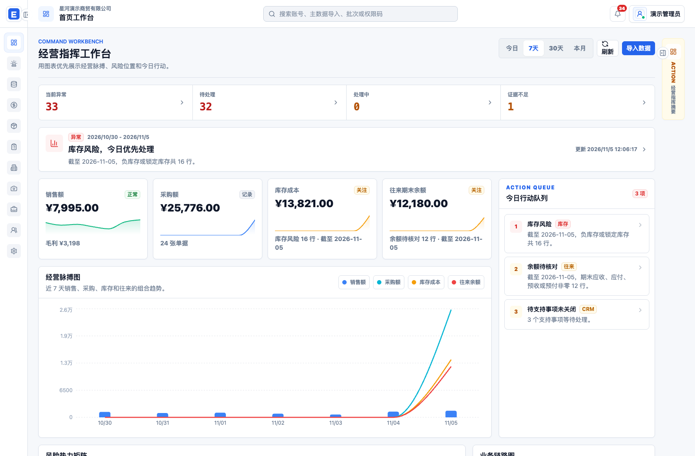
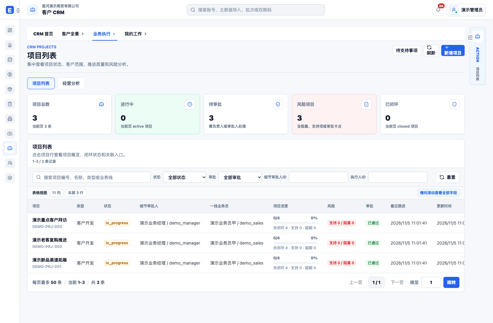
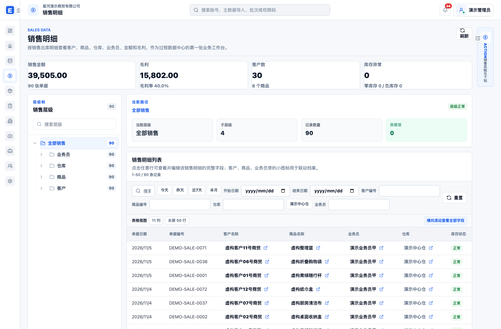

# 企业业务管理平台与 AI Agent

完整项目脱敏展示版：保留 Web 前后端、账号与权限、主数据、销售采购、库存与往来、CRM、审批、AI 助手、移动端源码和部署工具。数据来自独立生成的虚构样本。

[页面截图](docs/screenshots.md) · [功能与源码导航](docs/modules.md) · [本地启动](#快速启动) · [版本与验证](docs/validation.md) · [v0.2.0-full-project](https://github.com/wenzuowei333/enterprise-business-agent/releases/tag/v0.2.0-full-project)



## 项目覆盖

| 模块 | 展示内容 | 源码 |
|---|---|---|
| 经营工作台 | 销售、毛利、采购、库存摘要，行动队列与经营趋势 | `frontend/src/App.tsx`、`backend/app/api/routes/dashboard.py` |
| 主数据与导入 | 员工、客户、商品、供应商、分类、客户画像、文件预览与确认 | `backend/app/services/import_service.py`、`backend/app/models/master_data.py` |
| 销售、采购与往来 | 明细筛选、层级分类、往来对账与应收核验 | `backend/app/api/routes/process_data.py`、`receivables.py` |
| 库存与履约 | 库存快照、盘点校验、流水、订单及配送执行 | `inventory_check.py`、`inventory_flow.py`、`fulfillment.py` |
| 客户 CRM | 项目、任务、跟进、线索开发、经营资料、标签、报表和复盘 | `backend/app/services/crm_*`、`backend/app/api/routes/crm_*` |
| 审批与协作 | 审批流、退回补充、项目撤回、待支持事项与审计 | `approval_service.py`、`work_item_service.py` |
| AI / Agent | 业务上下文、统一编排、证据约束诊断、SSE 对话、受控动作与租约任务 | `global_ai_orchestrator.py`、`hermes_ai_service.py`、`exception_task_service.py` |
| 账号与权限 | 角色模板、用户覆盖、数据范围、字段脱敏、操作审计 | `access_control_service.py`、`permission_service.py` |
| 图片处理 | 图片上传、批处理、下载与清理；水印已换成 DEMO 素材 | `backend/app/api/routes/image_processing.py`、`tools/image_batch_processor/` |
| Android | Compose 页面、Room 离线数据、同步、上传、更新与移动 API | `android/`；本次未构建或发布 APK |





全部界面截图及模块说明见 **[页面截图集](docs/screenshots.md)**。所有截图均来自实际运行的应用，界面上显示的客户、供应商、员工、单据和金额均为合成数据。

## 快速启动

需要 Docker Compose v2。第一次启动会构建原有 React 界面，执行完整 Alembic 迁移并初始化演示业务数据。

```bash
git clone https://github.com/wenzuowei333/enterprise-business-agent.git
cd enterprise-business-agent
docker compose -f docker-compose.demo.yml up -d --build --wait
```

打开 **http://127.0.0.1:18210**。账号 `demo_admin`，密码 `LocalDemo-2026!`；另有同密码的 `demo_sales`、`demo_manager`、`demo_viewer` 可对照角色权限。账号仅供本机演示。

演示库含 30 个虚构客户、8 种商品、4 个供应商、90 条销售、24 条采购、16 条库存，以及 CRM 项目、任务、跟进、线索和审批。种子可重复执行，会保留已经操作的业务数据。

```bash
# 验证完整应用的规则扫描、独立 Worker 和本地 Mock 诊断
python3 demo/full_smoke.py
# 关闭本演示；加 -v 才会清空专用演示卷
docker compose -f docker-compose.demo.yml down
```

根目录 `docker-compose.yml`、`backend/Dockerfile` 与 `deploy/` 保留的是已脱敏的原部署模板。招聘展示请使用上面的 `docker-compose.demo.yml` 与 `Dockerfile.demo`；原始运维主机、组织标识、品牌素材、内部报告和生产文件不随展示版发布。

## 技术与 AI 边界

FastAPI / SQLAlchemy / PostgreSQL / Alembic；React / TypeScript / Vite / Tailwind / Recharts；Android Compose / Room。保留业务接口、权限及审计链路，AI 是完整业务平台中的一个模块。

默认使用仓库内的 **本地 Mock Provider**，诊断通过真实数据库队列和独立 Worker 执行。Mock 文本明确标识演示性质；外部 Provider 的实现保留，演示配置没有真实 Key。自动修复写入、外部执行沙箱等高风险能力默认关闭，代码与原有契约测试可查阅。没有用固定文本冒充真实模型质量或简历后续版本的生产统计。

## 版本与来源

本版从此前锁定的 GitHub 完整应用快照恢复业务模块；新增中立标识、完整合成种子、独立演示入口和截图，保留原源码中的业务结构。所选源快照早于简历后续维护月份，尚未推送的本地更新不在本版中。

旧版 `v0.1.0-showcase` 仍保留，记录此前精简库存诊断演示及录屏；本版 `v0.2.0-full-project` 用于完整项目招聘展示。模块覆盖及文件变化记录见 [modules](docs/modules.md) 和 [source coverage](docs/source-coverage-full.json)。

原有权利与第三方许可继续保留，本仓库没有额外授予 MIT/Apache 许可。[第三方依赖清单](docs/dependency-licenses-full.json) 包含完整应用环境；依赖的许可声明随依赖和构建产物保留。
