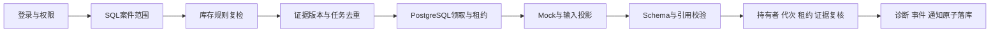

# 企业库存异常诊断与可靠 AI 工作流

**阶段三已实现最小闭环：登录 → 受限案件 → 库存规则复检 → 诊断入队 → 独立 Worker → 引用校验 → 所有权与证据复核 → 结果展示。** 所有库存、商品、账号和模型响应均为合成或 Mock，无需模型密钥。

## 一键启动

在本候选目录执行，需要 Docker Compose：

```sh
docker compose --profile app up -d --build api worker --wait
```

打开 **http://127.0.0.1:18130**。首次启动会迁移并初始化独立的演示库。

| 账号 | 可见范围 | 权限 |
|---|---|---|
| demo_admin | 全部 6 案 | 查看、诊断、复检、审计 |
| demo_east | 东仓 4 案 | 查看、诊断、复检 |
| demo_viewer | 东仓 4 案 | 只读 |

演示密码统一为 `LocalDemo-2026!`，仅用于本地隔离环境。所有发布端口只绑定本机，外部凭据为空，不隐式读取 `.env` 或上级配置。

选择案件后可提交正常诊断、证据不足、格式错误、未知引用、超时五种 Mock 响应。页面读取真实数据库状态；正常诊断仍需人工核实，completed 不等于库存已修复。失败任务不会生成新结论。

停止：`docker compose --profile app stop`。恢复初始样本：`docker compose --profile app down -v` 后重新启动；这只删除本候选的专用演示数据卷。

## 本机开发

需要 Python 3.12：

```sh
uv venv --python 3.12
uv pip install -r backend/requirements.lock
docker compose up -d postgres --wait
.venv/bin/python demo/bootstrap.py
PYTHONPATH=backend:. .venv/bin/python -m uvicorn app.main:app --host 127.0.0.1 --port 18130
```

另一终端启动独立 Worker：

```sh
PYTHONPATH=backend:. .venv/bin/python -m app.tasks.exception_ai_worker --worker-id demo-worker
```

本机演示库端口为 25434，库名为 `inventory_demo`，不复用阶段二的 25432。已有诊断任务时，种子初始化会保留工作流历史。

## 验证

```sh
uv pip install -r backend/requirements-dev.lock
.venv/bin/python demo/run_checks.py
```

测试只重置 **25435 端口的专用临时 PostgreSQL**，覆盖权限、证据、并发领取、预算、心跳和真实进程中断/迟到回写。没有用 SQLite 代替 PostgreSQL 租约验证。

可选浏览器验收，先启动应用：

```sh
uv pip install -r backend/requirements-browser.txt
.venv/bin/python -m playwright install chromium
.venv/bin/python demo/browser_smoke.py
```

运行记录与截图写入被 Git 排除的 `runtime/`。实际执行范围见 `docs/phase3-acceptance.md`。

## 关键机制



案件、证据、任务、结果和事件共用服务端范围控制。创建诊断使用案件行锁与原活动任务部分唯一索引去重；领取保留原 admission 锁、`FOR UPDATE SKIP LOCKED`、并发上限和 `attempts` 代次。

Provider 调用不占有案件/任务事务锁。写回重新检查持有者、代次、有效租约、来源、证据版本和请求者当前权限。心跳不能复活过期租约。此版只写诊断工作流，不提供修改库存数量的 API。

超时最多两次执行，无效格式/引用直接失败。额度按 UTC 日保守预留，每次尝试记一条事件，进程中断不退还已预留次数；Mock 不产生模型费用。

## 来源与边界

源快照：`a33686b5b0d3bc9e2d2eb4d85b76b8346afea5be`。源函数复用、适配改动与新建登录/页面/Worker 外层分别记录于 `docs/phase3-adaptations.md`，符号清单见 `docs/source-provenance-phase3.json`。

此版展示受控 AI 诊断工作流。自主工具规划、MCP、LangGraph、混合检索、业务自动修复、原生产规模和后续生产成功率不在当前承诺中。6 秒演示租约和 0.9 秒测试租约短于源配置，不应外推为生产容量或长期可靠性结论。

尚未发布 GitHub。阶段五复现与内容验收已完成；后续继续准备招聘展示材料与发布。

## 阶段五验收入口

在独立干净检出目录安装依赖（需要 Python 3.12、uv、Docker Compose 2.24.4+）：

```sh
uv venv --python 3.12
uv pip install -r backend/requirements-dev.lock playwright==1.58.0
.venv/bin/python -m playwright install chromium
COMPOSE_PROJECT_NAME=portfolio-inventory-acceptance SHOWCASE_IMAGE_TAG=phase5 .venv/bin/python ci/run.py --fresh-data-check
```

命令面向本机演示端口空闲、该 Compose 项目尚不存在的环境。已有相同端口演示时先使用独立端口覆盖；更换项目名不会自动解除宿主机端口冲突。

该入口要求新的 Compose 项目和空数据卷，实际验证种子重复/新卷重建后数据摘要一致，再运行回归和浏览器案例。运行阶段限制外网连接，详见 [阶段五验收](docs/phase5-acceptance.md)。已有演示项目不要传 `--fresh-data-check`；需要与现有服务并存时，在独立 Compose 项目中覆盖端口和镜像标签。

本候选暂按本地/私有展示处理，上游没有许可证授权声明；见 [来源与许可边界](docs/licensing.md)。CI 工作流已编写，本地执行记录与远程 GitHub Actions 运行状态分别报告。

本轮实测摘要、版本、耗时与修复记录见 [阶段五结果](docs/phase5-acceptance.md)。旧阶段报告保留原始时间与口径。
