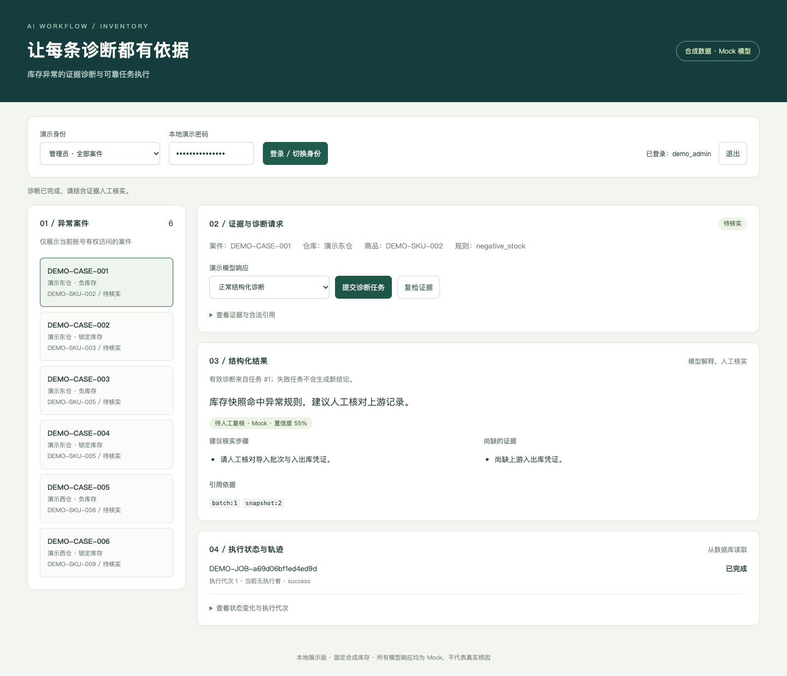

# 企业库存异常诊断 AI 工作流

把库存异常证据送入受控诊断流程，确保结果受权限、引用与任务归属约束。

**个人职责：原项目独立全栈开发，负责需求梳理、系统设计、前后端实现与部署。** 本仓库仅展示其中可核验的工作流切片；职责源于项目经历自述，源实现与本次展示适配分开记录。

`Python` · `FastAPI` · `PostgreSQL` · `独立 Worker` · `结构化输出校验` · `HTML / JavaScript`



▶ **[观看 约 78 秒实际操作录屏](docs/assets/demo.mp4)** · [分镜与字幕](docs/demo-script.md) · [90 秒／5 分钟面试讲解](docs/interview-guide.md)

录屏由本候选业务代码在独立本机环境运行产生，按实际时间录制，只增加讲解字幕。模型响应和图片均为 Mock/程序合成；页面状态来自 API、数据库和独立 Worker。视频不是模型效果评测。

## 三个可复核的技术点

| 技术点 | 直接证据 |
|---|---|
| 权限在查询与回写两端生效 | [实现](backend/app/services/access_control_service.py#L27) · [复现测试](tests/test_access_and_api.py#L27) |
| 用租约与执行代次隔离迟到 Worker | [实现](backend/app/services/source_task_functions.py#L154) · [复现测试](tests/test_postgres_reliability.py#L158) |
| 解释必须受证据契约与当前版本约束 | [实现](backend/app/services/evidence_contract.py#L416) · [复现测试](tests/test_diagnosis_boundaries.py#L81) |

[架构与关键时序](docs/architecture.md) · [三个设计取舍](docs/design-decisions.md) · [简历主张与证据](docs/resume-evidence.md)

## 启动与演示

需要 Docker Engine、Compose 2.24.4+；首次构建需要访问依赖源，依赖镜像已锁定内容摘要。在项目根目录执行：

```sh
docker compose --profile app up -d --build api worker --wait
```

打开 **http://127.0.0.1:18130**。首次启动自动执行迁移与合成种子；已有工作流数据会保留。请先确保默认演示端口未占用；另建 Compose 项目时也需分别覆盖宿主机端口。

| 演示账号 | 范围 |
|---|---|
| demo_admin | 全部六个合成库存案件 |
| demo_east | 东仓四案，可诊断和复检 |
| demo_viewer | 东仓四案，只读 |

统一演示密码：`LocalDemo-2026!`，仅用于本机隔离环境。停止：`docker compose --profile app stop`。恢复与删除专用数据卷的区别、开发方式及端口见 [完整运行手册](docs/runbook.md)。

推荐路径：管理员 → DEMO-CASE-001 → 正常诊断 → 查看引用 → 证据不足 → 未知引用失败 → 切换 demo_viewer 查看权限收缩。

[正常／失败场景与预期](docs/demo-scenarios.md) 说明每一步输入、操作和结果判定，不用 HTTP 200 代替业务成功。

## 已实际验证

2026-11-03 阶段五：**33 项后端回归，另有 6 组浏览器场景，最终无失败或跳过。** 已通过干净检出、新数据卷、重复种子和再次新卷重建。阶段六只新增展示文档与媒体，业务实现保持阶段五版本；录屏路径另外实际执行。

[可携带的脱敏验收摘要](docs/assets/acceptance-summary.json) · [测试口径与命令](docs/evaluation.md) · [阶段五详细说明](docs/phase5-acceptance.md)

```sh
uv venv --python 3.12
uv pip install -r backend/requirements-dev.lock playwright==1.58.0
.venv/bin/python demo/run_checks.py
```

前述命令执行后端测试，需要专用测试端口空闲；完整离线运行策略、浏览器与空卷复现入口见 [evaluation.md](docs/evaluation.md)。不声称首次下载“五分钟启动”。远程 GitHub Actions 尚未运行，本地验证入口已通过。

## 版本、数据与许可

这是脱敏展示候选，当前保留在本地／私有范围，尚未公开 GitHub。源快照、逐字复用／展示适配与后续未同步能力见 [版本边界](docs/version-scope.md)。

本版没有通用工具规划器、MCP、混合检索或自动修改库存。展示的是确定性证据驱动的受控 AI 诊断；租约隔离本地回写，不能保证外部模型调用和收费严格一次。

数据、账号与商品均为固定合成样本，未复制生产导出，见 [脱敏记录](docs/redaction.md)。上游未携带 LICENSE/COPYING/NOTICE；未额外授予开源许可。依赖保留各自许可，详见 [来源与许可边界](docs/licensing.md) 和 [第三方声明](THIRD_PARTY_NOTICES.md)。公开权属确认与正式发布留待后续处理。
