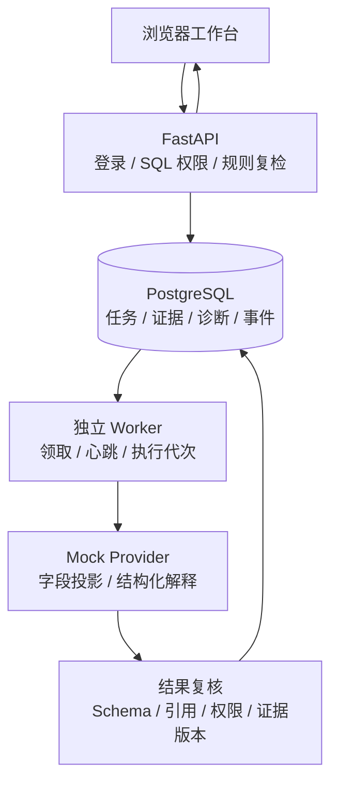
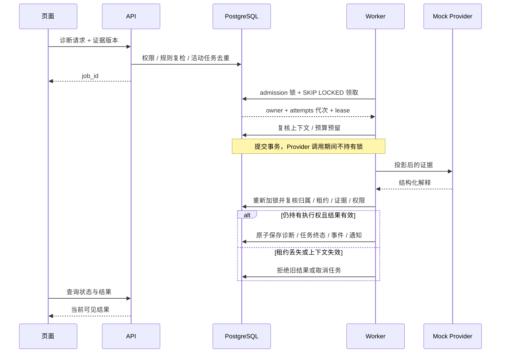

# 架构与关键时序

目标是让一条库存异常从可见范围、证据准备、诊断执行到结果落库都保留可检查的约束。页面只是入口；权限、来源版本和 Worker 归属由服务端决定。

部署仅有 API、Worker、PostgreSQL 三类业务进程；不依赖 Redis。19 张展示模型表不代表原 ERP 全部表。页面轮询任务状态；证据、诊断、事件和通知在本地持久化。统一 CI 额外用内部网络与固定服务入口隔离运行，依赖安装仍可联网。

主要入口：[SQL 范围](../backend/app/services/access_control_service.py#L27)、[领取](../backend/app/services/source_task_functions.py#L72)、[调用前后复核](../backend/app/services/exception_task_service.py#L120)、[原子保存](../backend/app/services/source_task_functions.py#L223)。

字段投影不等于模型绝不会出错；Schema 合法也不证明根因正确。证据不足允许形成“缺口”结果，必须人工核实。当前全局 mutation/admission 锁简化固定锁顺序，也限制吞吐；没有容量测试结论。

源领取/落库符号与展示适配分别列在 [适配说明](phase3-adaptations.md)。外部 LLM、通用工具目录和生产 ERP 全量界面不属于当前部署图。

可导出图：[架构 SVG](assets/architecture.svg) · [关键时序 SVG](assets/sequence.svg)。Mermaid 源码保留在本页，便于后续维护。
