# 完整项目页面截图

截图日期：2026-11-05。以下均为实际运行的完整应用页面；业务记录、账号与商品素材为合成数据。

[返回项目首页](../README.md)

## 经营工作台

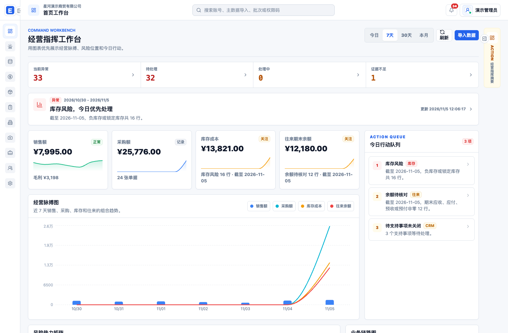

## 客户主数据

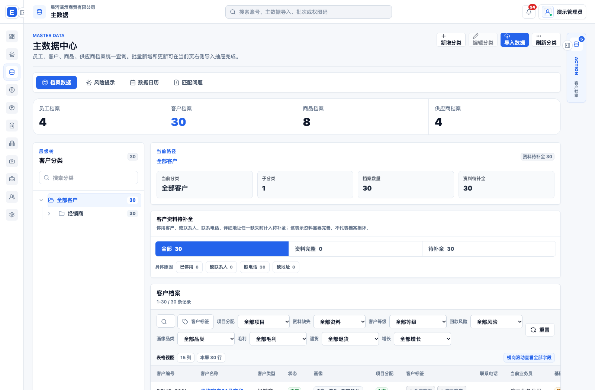

## 销售明细

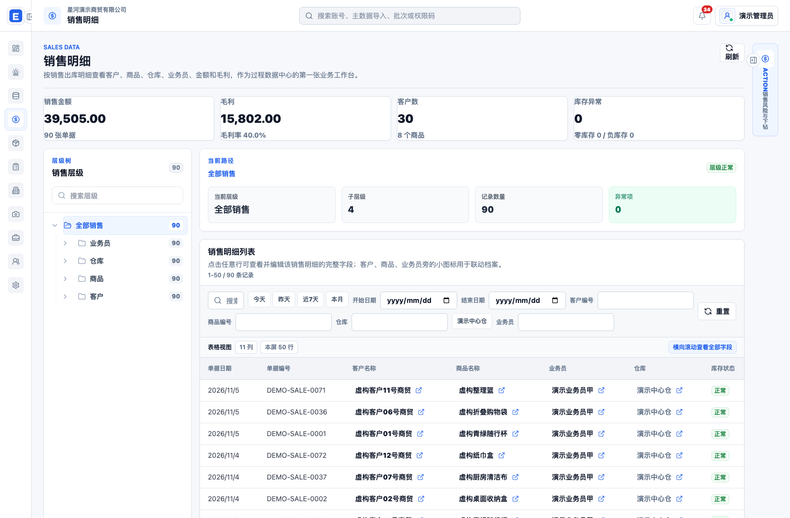

## 库存快照

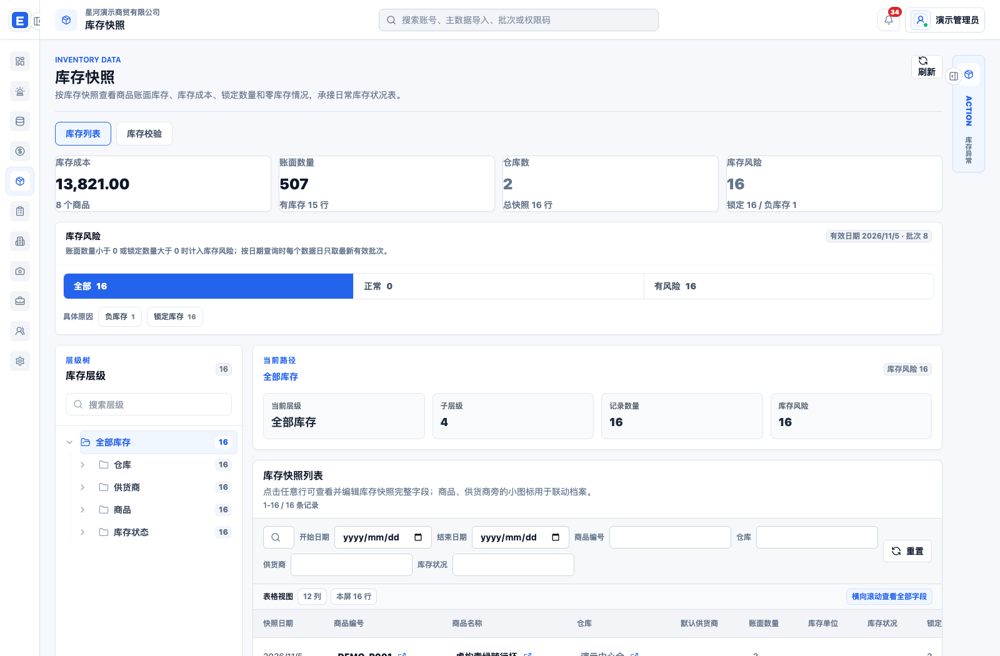

## 采购明细

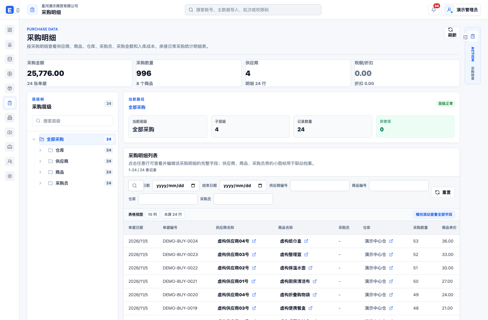

## 往来对账

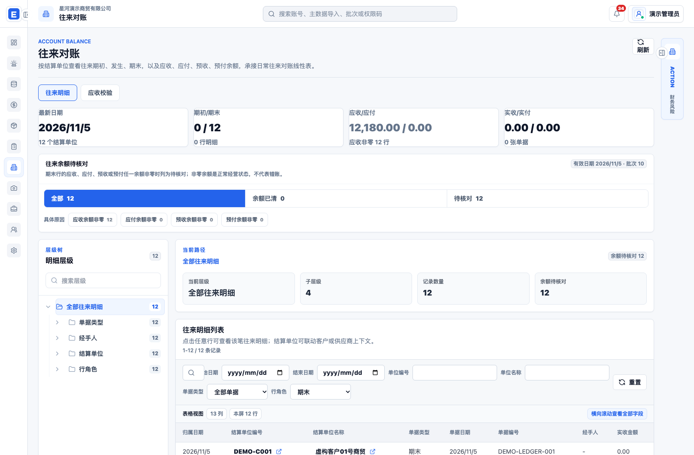

## 客户 CRM

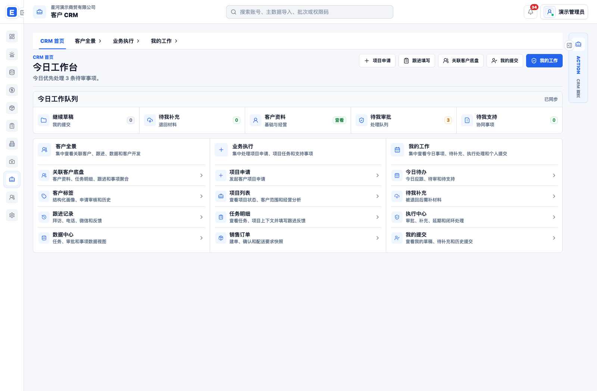

## 客户项目

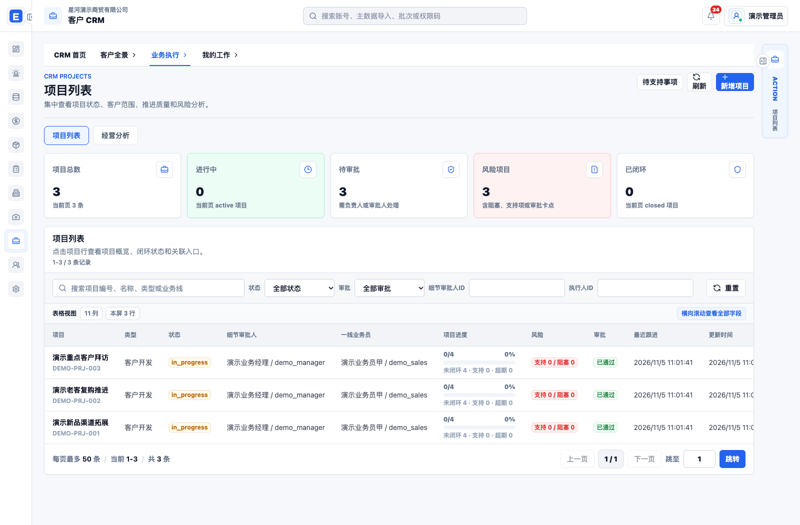

## 客户开发

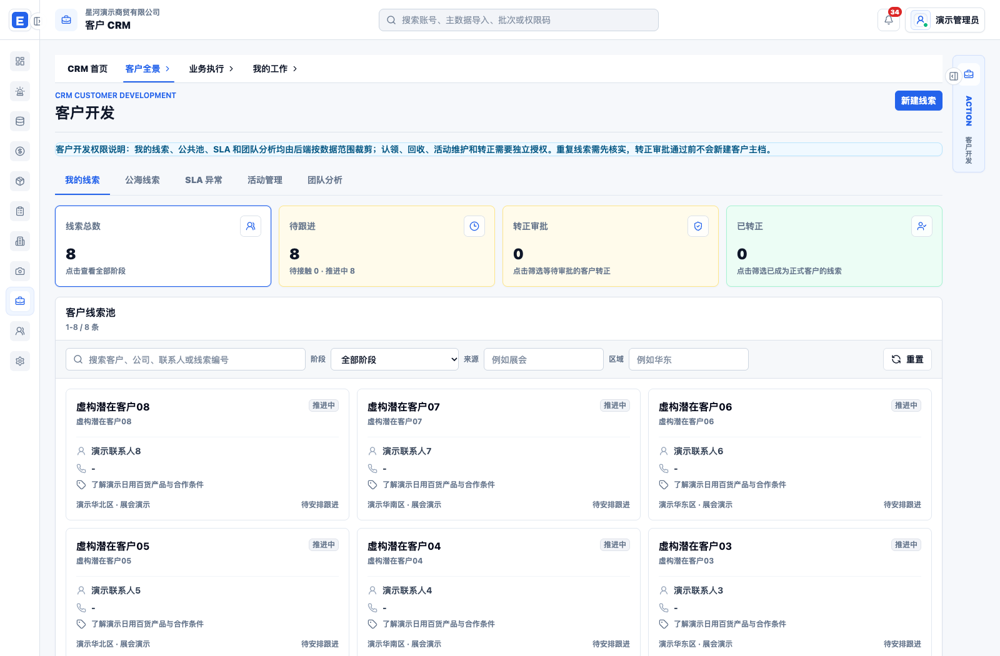

## 客户任务

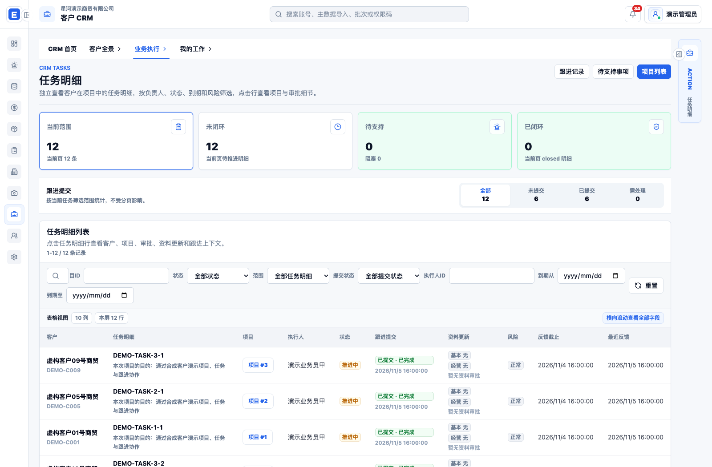

## 执行与审批

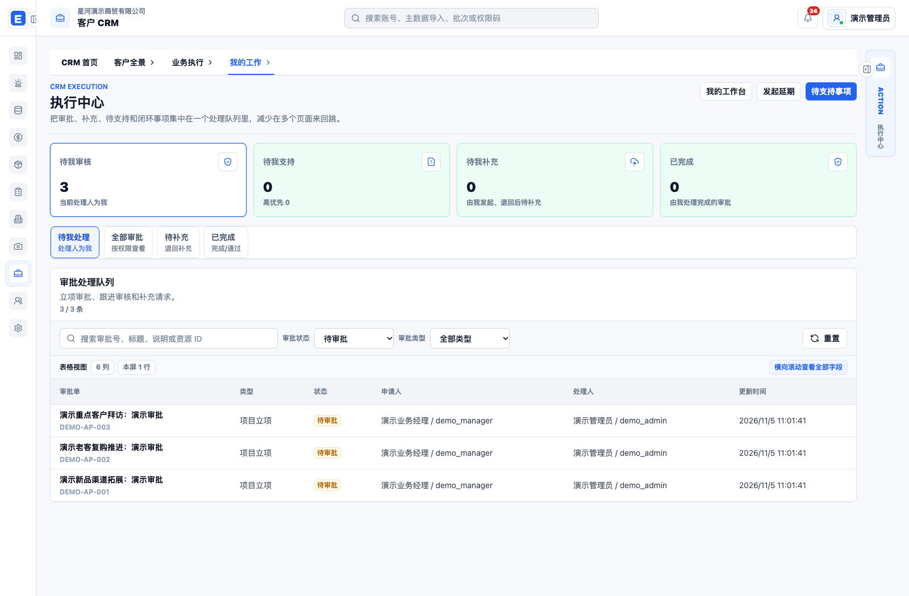

## 异常与 AI

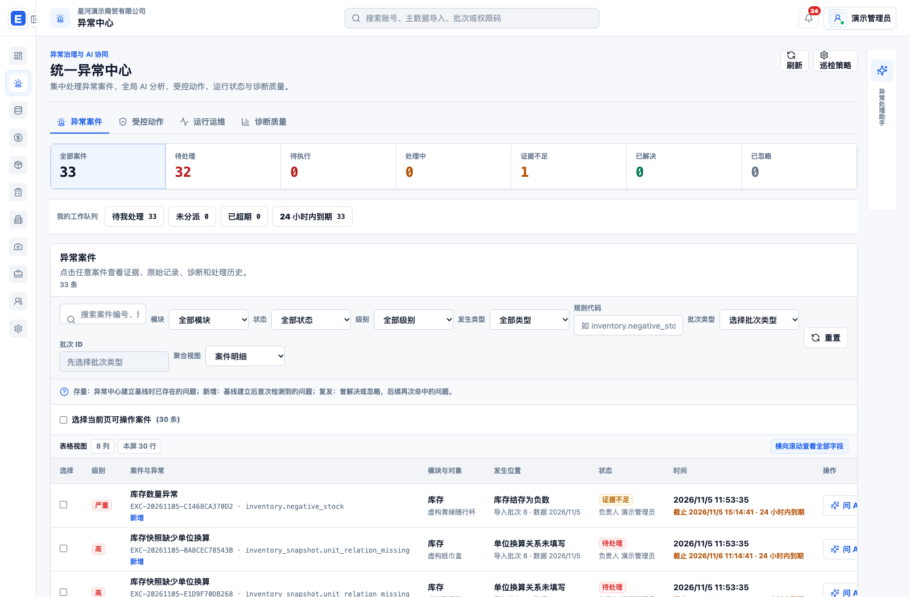

## 账号与权限

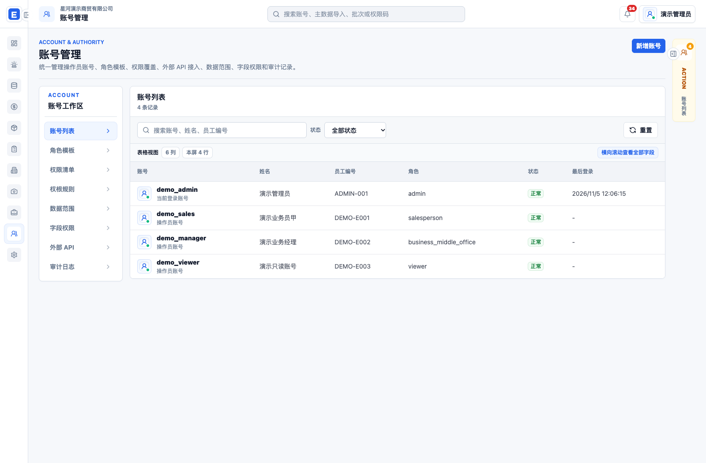

## 图片处理

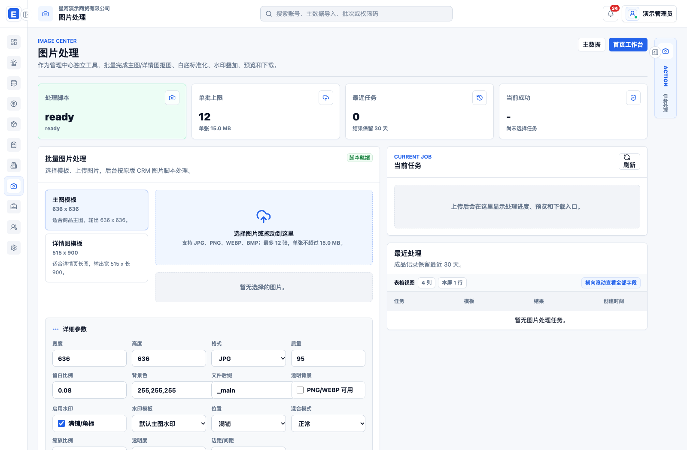

